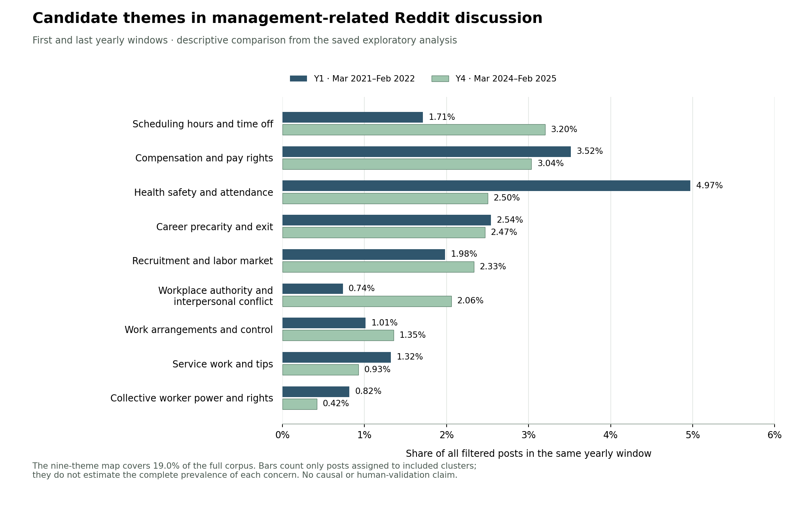

# Antiwork Subreddit Analysis

Exploratory longitudinal analysis of management-related r/antiwork discussion, March 2021 through February 2025.

**Research question:** What themes appear in these discussions, how do their observed shares change over time, and how much of the corpus does the model describe?

The project combines BERTopic, a documented candidate-theme codebook, coverage-aware trends and robustness checks. A separate analysis examines model-estimated whole-post sentiment. Code, aggregate evidence and dated drafts are shared; raw posts remain local.

**[Reading guide](docs/READING_GUIDE.md)** · **[Run the aggregate example](docs/REPRODUCING.md)** · [Research handoff](planning/WRITING_HANDOFF.md) · [Robustness checks](planning/ROBUSTNESS.md)

## Scope at a glance

| Measure | Saved result | Interpretation |
| --- | ---: | --- |
| Filtered corpus | 97,254 posts across 48 months | Management-related sampling frame, not all workplace discussion |
| Non-outlier assignments | 37,536 posts, 38.6% of the corpus | Posts assigned to one of 199 BERTopic clusters |
| Included candidate-theme map | 18,506 posts across 27 clusters and nine themes | 19.0% of the full corpus; 49.3% of non-outlier assignments |

The map is exploratory and incomplete. A post outside it is not evidence that a concern is absent. Results are descriptive, not causal, representative workforce estimates or human-validated theme labels.

## Selected descriptive findings

These shares use **all filtered posts in the same yearly window** as the denominator. Numerators include only posts assigned to the relevant mapped clusters.

| Candidate theme | Mar 2021–Feb 2022 | Mar 2024–Feb 2025 |
| --- | ---: | ---: |
| Health safety and attendance | 4.97% | 2.50% |
| Scheduling hours and time off | 1.71% | 3.20% |
| Compensation and pay rights | 3.52% | 3.04% |

These results describe changes within the mapped discussion. They do not estimate the complete prevalence of each concern or explain what caused the changes. The [writing handoff](planning/WRITING_HANDOFF.md) records the fuller results and qualifications.



The example is rebuilt from the committed [window-level aggregate CSV](outputs/v2_clean_min25/analysis/candidate_theme_window_prevalence.csv). The original [research figures](outputs/v2_clean_min25/figures/) remain preserved, including the [monthly assignment-coverage figure](outputs/v2_clean_min25/figures/monthly_assignment_coverage.png).

## Try the shared evidence

Python 3.10+; the lightweight checks use its standard library and need no raw data, embeddings, model download or credentials:

```bash
python scripts/validate_public_aggregates.py
python -m unittest discover -s tests_public -v
```

To rebuild the example figure and source summary:

```bash
python -m pip install "matplotlib>=3.8,<4"
python scripts/rebuild_aggregate_example.py
```

Output goes to `examples/output/`. The script checks counts, denominators, shares and coverage before plotting. These are consistency checks on existing evidence, not a rerun or validation of the topic model. See [reproduction details](docs/REPRODUCING.md) for the full research workflow.

## Navigate the research

- [Reading guide](docs/READING_GUIDE.md): evidence, historical planning, separate analyses and local-only dependencies.
- [Codebook](planning/CANDIDATE_THEME_CODEBOOK.csv): included and excluded clusters with review notes.
- [Writing handoff](planning/WRITING_HANDOFF.md): results and interpretation boundaries for its documented draft cycle.
- [Robustness notes](planning/ROBUSTNESS.md): corpus audit, seed stability, text-mode sensitivity and alignment.
- [Sentiment method](planning/SENTIMENT.md): the separate whole-post polarity check. Outputs are model-based, not human-validated or management-targeted sentiment labels.
- [Dated deliverables](deliverables/): briefs, manuscript drafts and visual appendices. Presence does not establish publication or final approval.

Historical notes retain the decisions and questions of their original stage. The reading guide distinguishes the original title-only inventory, later title-and-body corpus, topic-study scope and separate sentiment check.

## Contributors and context

The project extends the Mitropoulos and Minton SIOP 2023 study. The current project records Mitropoulos and Ristow as authors in its [package metadata](pyproject.toml) and [project notes](planning/PROJECT.md). Individual task contributions are not inferred from commit counts or rewritten here.

## Data handling

Raw Reddit text, cached embeddings, sampled post excerpts, virtual environments and non-aggregate outputs remain local and excluded from this repository. Historical notes refer to some local-only inputs; their absence from the public tree is intentional. The aggregate example uses only files already shared here.
